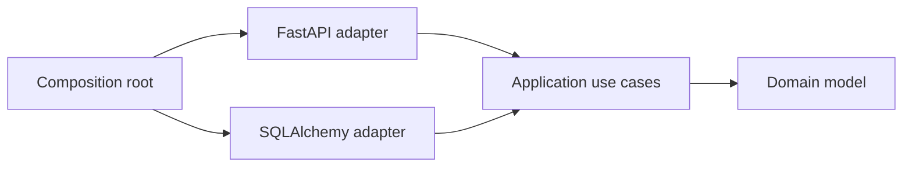

# Architecture

## Shape

This service is one deployable process split into business modules. A module owns its data model
and contains four explicit layers:

```text
modules/<name>/
  contracts/       # stable API available to other modules
  domain/          # entities, value objects, domain errors
  application/     # use cases and outbound ports
  infrastructure/  # SQLAlchemy and external-service adapters
  api/             # FastAPI inbound adapter
```



The composition root in `app.main` and `app.container` is the only place that knows every
adapter. The architecture test rejects outward imports from domain/application layers and rejects
cross-module imports that bypass `contracts`.

## Runtime boundaries

- A use case owns one unit-of-work boundary.
- Each module owns its tables and migrations; other modules do not query them directly.
- Expected business failures become RFC-style problem responses at the HTTP boundary.
- Migrations run as a deployment step, never implicitly during application startup.
- Readiness checks the database; liveness only checks the process.
- Request IDs, structured logs, bounded-cardinality metrics, and UTC timestamps are built in.

For cross-module work that must be atomic, call a stable application contract in the same unit of
work only when both modules share a deliberate transaction boundary. For asynchronous work, add a
transactional outbox before publishing events. Do not publish to a broker before the database
commit.

## Future RAG module

Add RAG as a new `knowledge` module rather than placing model or vector-store clients in `core`:

```text
modules/knowledge/
  contracts/       # document-ingested and answer/query contracts
  domain/          # document, chunk, citation, retrieval-policy concepts
  application/     # ingest/query use cases; model/vector/document-store ports
  infrastructure/  # provider SDKs, object storage, pgvector/vector database
  api/              # ingestion and retrieval endpoints
```

Keep chunking, embedding, retrieval, reranking, and generation as separate application ports. This
allows providers and evaluation strategies to change independently. Run ingestion from an outbox
consumer/background worker built from the same repository; do not perform embedding inside a
request transaction.

Before exposing RAG, add tenant and document ACL filters to every retrieval query, prompt-injection
controls, source provenance, model/token/cost metrics, offline evaluation datasets, idempotent
ingestion, and retention/deletion workflows. A vector index is derived data; the authoritative
document store and ingestion state remain transactional records.